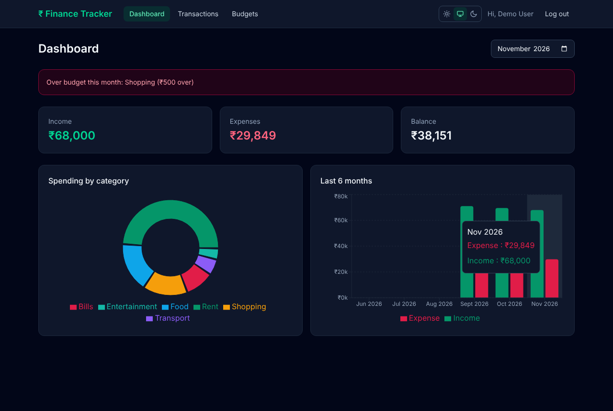
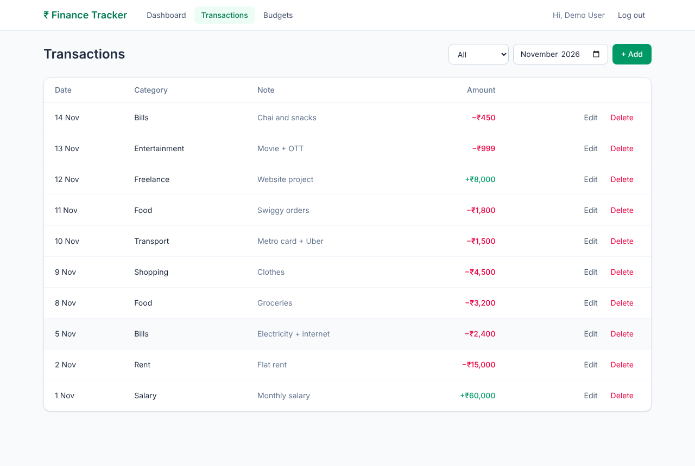
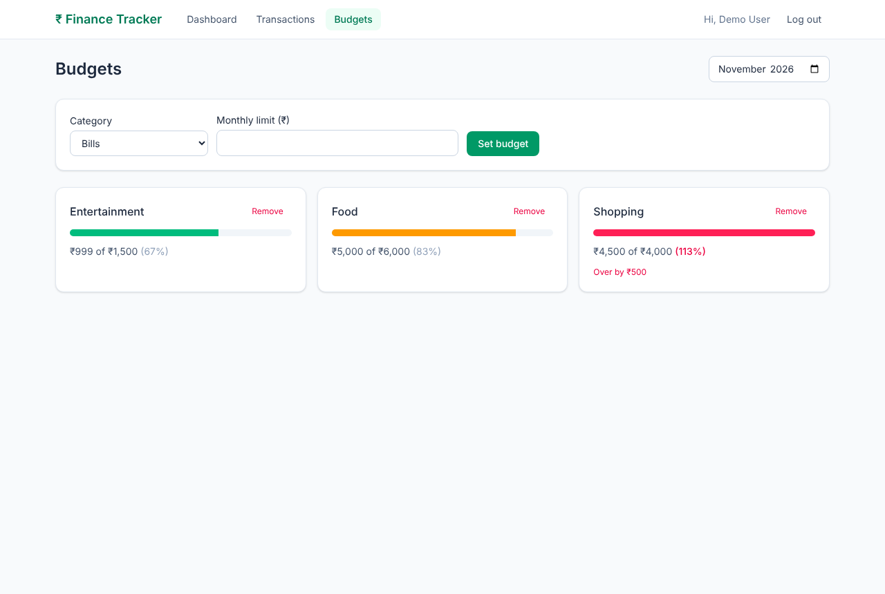

# ₹ Finance Tracker

A full-stack personal finance app for tracking income and expenses, setting monthly budgets per category, and seeing where your money goes through charts.


## Features

- **Accounts**: sign up and log in with hashed passwords (bcrypt) and JWT authentication
- **Transactions**: add, edit, delete and filter income and expenses by month and type
- **Categories**: sensible defaults (Food, Rent, Salary…) created for every new user
- **Dashboard**: monthly income, expenses and balance, a spending-by-category donut chart, and a 6-month income-vs-expense bar chart
- **Budgets**: set a monthly limit per category, with progress bars that turn amber at 80% and red when you go over, plus an over-budget alert on the dashboard
- **Light and dark theme**: follows your system setting by default, with a toggle to pick light, dark or system; the choice is remembered
- **Data isolation**: every query is scoped to the logged-in user, and this is covered by tests

## Tech stack

| Layer | Tech |
|---|---|
| Frontend | React 19, TypeScript, Vite, Tailwind CSS, Recharts, React Router |
| Backend | Node.js, Express, TypeScript, Zod (validation) |
| Database | PostgreSQL with Drizzle ORM (type-safe queries and SQL migrations) |
| Auth | JWT + bcrypt |
| Testing | Vitest + Supertest (API integration tests against a real database) |

## Project structure

```
finance-tracker/
├── client/                 # React frontend
│   └── src/
│       ├── api/            # fetch wrapper + shared types
│       ├── components/     # Layout, Modal, TransactionForm, MonthPicker
│       ├── context/        # AuthContext (login state)
│       └── pages/          # Dashboard, Transactions, Budgets, Login/Register
└── server/                 # Express API
    ├── drizzle/            # generated SQL migrations
    ├── src/
    │   ├── db/             # schema, connection, migrate + seed scripts
    │   ├── middleware/     # JWT auth, error handler
    │   └── routes/         # auth, transactions, categories, budgets, stats
    └── tests/              # API tests
```

## Running it locally

**Prerequisites:** Node.js 20+ and PostgreSQL (installed locally, or a free cloud database from [Neon](https://neon.tech)).

1. **Create a database** called `finance_tracker`.

2. **Start the backend**
   ```bash
   cd server
   npm install
   cp .env.example .env      # on Windows: copy .env.example .env
   # edit .env: set DATABASE_URL to your database and JWT_SECRET to any long random string
   npm run db:migrate        # creates the tables
   npm run db:seed           # optional: demo user with 3 months of sample data
   npm run dev               # API on http://localhost:4000
   ```

3. **Start the frontend** in a second terminal
   ```bash
   cd client
   npm install
   npm run dev               # app on http://localhost:5173
   ```

4. Open http://localhost:5173 and log in with **demo@example.com / demo12345**, or create your own account.

## Running tests

```bash
cd server
npm test
```

## API overview

All routes except `/api/auth/*` need an `Authorization: Bearer <token>` header.

| Method | Route | Description |
|---|---|---|
| POST | `/api/auth/register` | Create an account |
| POST | `/api/auth/login` | Log in, returns a JWT |
| GET | `/api/transactions?month=YYYY-MM&type=INCOME\|EXPENSE` | List transactions |
| POST / PUT / DELETE | `/api/transactions[/:id]` | Create, update, delete |
| GET / POST | `/api/categories` | List or add categories |
| GET | `/api/budgets?month=YYYY-MM` | Budgets with amount spent |
| POST / DELETE | `/api/budgets[/:id]` | Set (create or update) or remove a budget |
| GET | `/api/stats/summary?month=YYYY-MM` | Income, expense, balance, spending by category |
| GET | `/api/stats/monthly?months=6` | Income vs expense per month |

## Screenshots

**Dark mode**



| Transactions | Budgets |
|---|---|
|  |  |

## Roadmap

- [ ] CSV import for bank statements
- [ ] Recurring transactions (rent, subscriptions)
- [ ] Auto-categorisation from transaction notes (e.g. "Swiggy" → Food)
- [ ] Ask questions about your spending in plain English
- [ ] Deploy (Vercel + Render + Neon)
